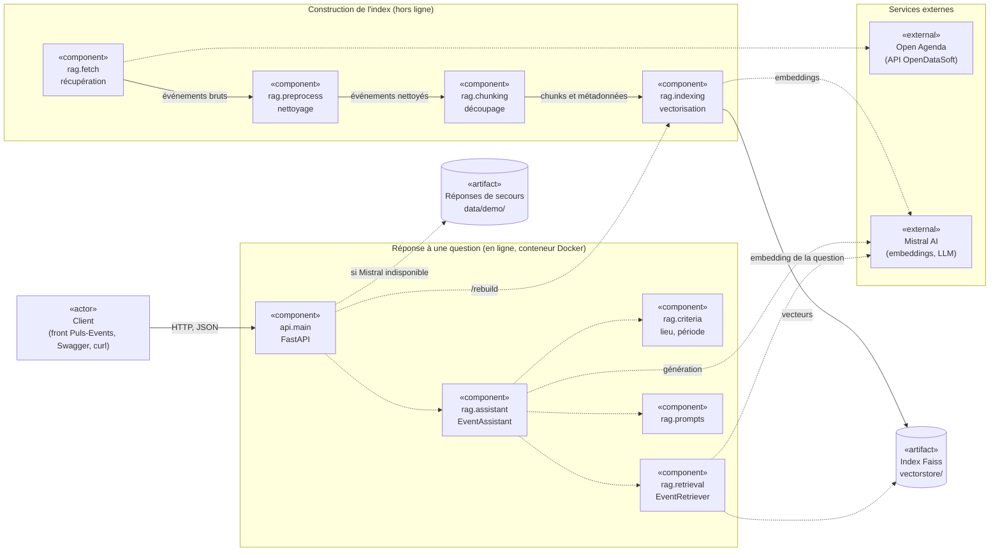
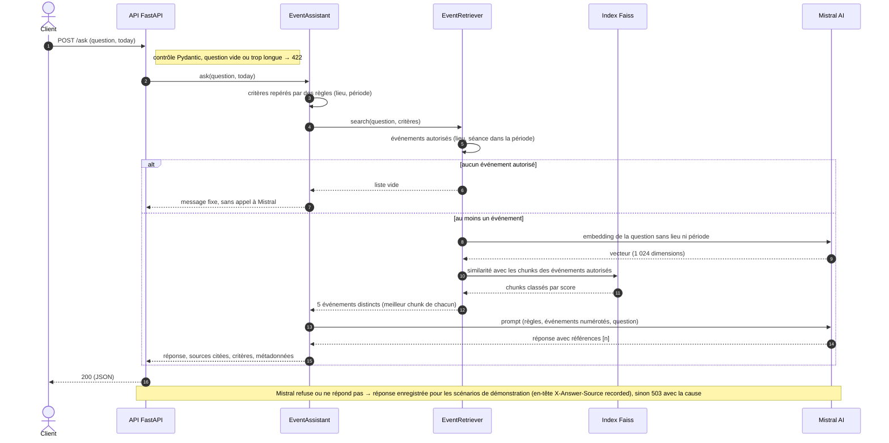

# Rapport technique — Assistant intelligent de recommandation d'événements culturels

**Puls-Events — Preuve de concept (POC) d'un assistant RAG**
Auteur : Nathanaëlle Debaque — novembre 2026
Dépôt : ce dépôt GitHub (installation et commandes dans le [README](../README.md))

---

## Sommaire

1. [Objectifs du projet](#1-objectifs-du-projet)
2. [Architecture du système](#2-architecture-du-système)
3. [Préparation et vectorisation des données](#3-préparation-et-vectorisation-des-données)
4. [Choix du modèle NLP](#4-choix-du-modèle-nlp)
5. [Construction de la base vectorielle](#5-construction-de-la-base-vectorielle)
6. [API et endpoints exposés](#6-api-et-endpoints-exposés)
7. [Évaluation du système](#7-évaluation-du-système)
8. [Recommandations et perspectives](#8-recommandations-et-perspectives)
9. [Organisation du dépôt GitHub](#9-organisation-du-dépôt-github)
10. [Annexes](#10-annexes)

---

## 1. Objectifs du projet

### Contexte

Puls-Events est une plateforme de recommandations culturelles. Elle souhaite proposer à ses utilisateurs un
**chatbot** capable de répondre en langage naturel à des questions comme « Un concert de jazz à Bordeaux ce
week-end ? » ou « Que faire à Angoulême en novembre ? », en s'appuyant sur les événements publiés dans
**Open Agenda**. Ce rapport présente la preuve de concept (POC) réalisée pour l'équipe technique, destinée à
être montrée aux équipes produit et marketing.

### Problématique : pourquoi un système RAG ?

Un modèle de langage (LLM) rédige bien, mais seul, il ne peut pas répondre à ces questions :

| Approche | Limite pour Puls-Events |
|---|---|
| LLM seul | Il ne connaît pas les événements locaux ; ses connaissances s'arrêtent à la date de son entraînement ; il invente des événements plausibles (hallucinations), sans lien vérifiable |
| LLM réentraîné (*fine-tuning*) sur les événements | Coûteux, à refaire chaque fois que l'agenda change (en continu) ; ne cite pas ses sources |
| Moteur de recherche par mots-clés | Ne comprend pas le sens (« une sortie en famille » ne contient pas « atelier pour enfants ») ; renvoie une liste, pas une réponse |

Le **RAG** (*Retrieval-Augmented Generation*, génération augmentée par la recherche) combine les deux forces :

1. **Recherche** : les événements sont vectorisés (embeddings) et rangés dans une base vectorielle ; une
   question est comparée **par le sens** aux événements, après filtrage sur le lieu et la date.
2. **Génération** : le LLM rédige la réponse **à partir des seuls événements trouvés**, en citant leurs
   références ; les liens affichés viennent des données, pas du modèle.

La réponse est ainsi **ancrée** dans des événements réels et à jour, **vérifiable** (sources et liens), et la
mise à jour se fait en reconstruisant l'index (≈ 12 minutes), sans réentraîner de modèle.

### Objectif du POC

| Ce qu'il faut démontrer | Comment le POC le démontre |
|---|---|
| **Faisabilité technique** | Chaîne complète et reproductible : récupération des données → nettoyage → vectorisation → base Faiss → chaîne LangChain → API REST, conteneurisée (Docker), testée (446 tests, sous Linux et Windows) |
| **Pertinence métier** | Réponses en français, ancrées dans de vrais événements, avec dates, lieux et liens ; honnêteté quand rien ne correspond (« aucun opéra à Limoges ce week-end », puis des alternatives) ; périmètre respecté (Toulouse hors région → redirection) |
| **Performance** | Évaluation chiffrée sur un jeu de test annoté de 20 questions : qualité de la recherche (événement attendu trouvé dans 100 % des cas), qualité des réponses (mesures automatiques et classement humain), temps de réponse (partie 7) |

### Périmètre

| Élément | Choix |
|---|---|
| Zone géographique | **Nouvelle-Aquitaine** (12 départements) : une région variée (grande métropole, villes moyennes, zones rurales), assez riche pour tester la recherche sans exploser le coût de vectorisation |
| Période | Événements **terminés depuis moins d'un an** et événements **à venir**, par rapport à la date de référence (`lastdate_end ≥ date de référence − 365 jours`) |
| Données | Jeu public « Événements publics OpenAgenda » (OpenDataSoft, licence *Open License v1.0*) ; **photo de référence du 29/10/2026** versionnée : 34 517 événements bruts → **18 771 événements** après nettoyage → **20 644 chunks** indexés |
| Date du jour | Paramétrable : vraie date par défaut ; **fixée au 29/10/2026** (date de la photo) pour l'évaluation et la démonstration, afin que les résultats soient reproductibles |
| Hors périmètre | Historique de conversation (non nécessaire pour le POC) ; interface graphique (l'API est documentée et testable dans Swagger) ; autres régions |

---

## 2. Architecture du système

Le système comporte **deux chaînes** :

- **hors ligne**, la **construction de l'index** : récupérer les événements, les nettoyer, les découper, les
  vectoriser et les ranger dans Faiss (script `build_index`, ou route `/rebuild` de l'API) ;
- **en ligne**, la **réponse à une question** : l'API reçoit la question, l'assistant repère les critères,
  cherche les événements dans l'index, puis le LLM rédige la réponse.

### 2.1 Schéma global : diagramme de composants (UML)

Flèche pleine : flux de données ; flèche pointillée : dépendance (« utilise »).



### 2.2 Trajet d'une question : diagramme de séquence (UML)



### 2.3 Rôle de chaque composant

| Étape | Composant | Rôle |
|---|---|---|
| **Données entrantes** | `rag/fetch.py` | Télécharge les événements de la zone et de la période depuis l'API OpenDataSoft (26 champs), les enregistre avec un en-tête de métadonnées (`data/raw/`) |
| **Prétraitement** | `rag/preprocess.py` | 13 règles de nettoyage : doublons, annulés, agendas hors sujet, dates aberrantes, HTML, heure de Paris… (partie 3) |
| | `rag/chunking.py` | 1 événement = 1 document ; découpe les descriptions longues ; répète un en-tête de contexte (titre, dates, lieu…) sur chaque chunk ; attache les métadonnées de filtrage |
| **Embeddings et base vectorielle** | `rag/indexing.py` | Vectorise les chunks avec `mistral-embed-2312` par lots, au débit autorisé ; construit l'index Faiss et l'enregistre avec un manifeste ; télécharge l'index publié (empreinte SHA-256 vérifiée) |
| **Intégration LLM avec LangChain** | `rag/criteria.py` | Repère par des règles le lieu (ville, département) et la période (« ce week-end », « en novembre », « le 14 novembre »…) |
| | `rag/retrieval.py` | Filtre les événements sur les métadonnées (lieu, séances dans la période), puis cherche par similarité ; garde le meilleur chunk de chaque événement, 5 événements |
| | `rag/prompts.py` | Message système (rôle, région, date du jour, 6 règles) et message utilisateur (critères, événements numérotés, question) |
| | `rag/assistant.py` | Chaîne **LangChain LCEL** : critères → recherche → branche (message fixe si aucun événement, sinon prompt → LLM) → réponse avec sources ; classe `EventAssistant` |
| **Exposition via API** | `api/main.py`, `api/schemas.py` | FastAPI : `/ask`, `/health`, `/metadata`, `/rebuild` (protégé) ; schémas Pydantic des requêtes et des réponses ; erreurs expliquées ; réponses de secours |
| | `scripts/serve.py`, `Dockerfile` | Lancement : prépare l'index s'il manque (téléchargement vérifié, sinon construction), puis lance l'API ; image Docker |
| **Évaluation** | `rag/evaluation.py`, `rag/judge.py`, `scripts/evaluate_rag.py` | Mesures sans LLM (recherche, citations, comportement), métriques Ragas avec un juge Mistral, comparaison au classement humain (partie 7) |

### 2.4 Technologies utilisées

| Brique | Outil (version) | Pourquoi |
|---|---|---|
| Langage | Python 3.12 | Version récente, exigée par LangChain et Ragas ; la même en local, dans Docker et dans la CI |
| Données | API OpenDataSoft Explore v2.1 (`/exports/json`), `httpx` 0.28 | Jeu public sans clé ; export complet en une requête (pas de pagination) |
| Préparation | `pandas` 3.1, `html.parser` (bibliothèque standard) | Exploration et contrôles ; extraction du texte HTML sans dépendance supplémentaire |
| Orchestration | LangChain : `langchain-core` 1.7, `langchain-mistralai` 1.1, `langchain-text-splitters` 1.1, `langchain-community` 0.4.2 | Imposé ; chaîne déclarative (LCEL), intégrations Mistral et Faiss prêtes à l'emploi |
| Embeddings | Mistral `mistral-embed-2312` (client `mistralai` 3.6) | Imposé (« vectorisation via Mistral ») ; multilingue, bon en français ; nom daté pour la reproductibilité |
| Base vectorielle | Faiss `faiss-cpu` 1.15, index `IndexFlatIP` | Imposé ; recherche exacte en ≈ 1 ms sur 20 644 vecteurs (partie 5) |
| LLM | Mistral **Ministral 8B** (`ministral-8b-2512`) | Accessible avec la formule gratuite de Mistral ; choix mesuré (partie 4) |
| API | FastAPI 0.162, Uvicorn 0.54, Pydantic 2.14 | Documentation Swagger automatique (`/docs`), contrôle des entrées, schémas typés |
| Évaluation | Ragas 0.4.4, `pytest` 9.2 | Métriques RAG standard (fidélité, pertinence, couverture, exactitude) ; tests automatisés |
| Déploiement | Docker (`python:3.12-slim`), Docker Compose | Lancement identique sur toute machine ; secrets fournis au lancement |
| Intégration continue | GitHub Actions | Tests sous Linux et Windows et construction de l'image à chaque push |

---

## 3. Préparation et vectorisation des données

### 3.1 Source de données : API Open Agenda

| Paramètre | Valeur |
|---|---|
| Jeu de données | [`evenements-publics-openagenda`](https://public.opendatasoft.com/explore/dataset/evenements-publics-openagenda/) (OpenDataSoft, mis à jour en continu) |
| Point d'accès | `/api/explore/v2.1/catalog/datasets/evenements-publics-openagenda/exports/json` : export complet, sans la limite de 100 résultats par page de l'API de recherche |
| Filtre (`where`) | `location_region = "Nouvelle-Aquitaine" AND lastdate_end >= date'2025-10-29'` (date de référence − 365 jours) |
| Champs (`select`) | 26 champs sur 56 (`rag/config.py`) : identification, descriptions, mots-clés, dates et séances, lieu, tarifs, âge, statut, mode de participation. **Les champs de contact des contributeurs (données personnelles) sont exclus** |
| Stockage | `data/raw/events_<zone>_<date>.json.gz`, avec un en-tête (date, filtre, nombre d'événements) ; la photo du 29/10/2026 est versionnée : l'évaluation et le jeu de test portent sur elle |

Les données brutes sont contrôlées par des **tests de données** (`tests/test_raw_data.py`) avec des seuils de
tolérance : une photo qui s'écarte trop (par exemple trop d'événements sans titre) est signalée.

### 3.2 Nettoyage

L'exploration (`notebooks/01_exploration.ipynb`) a chiffré les anomalies ; chaque règle en découle. Les règles
sont du **code rejoué à chaque reconstruction** de l'index : elles sont génériques, valables pour une photo
future.

| Anomalie constatée | Règle | Effet (photo du 29/10/2026) |
|---|---|---|
| 44 % des événements viennent d'agendas d'**offres d'emploi et de formation** (« Mes événements France Travail »…), hors sujet pour une plateforme culturelle | Exclusion d'une **liste relue** d'agendas (`EXCLUDED_AGENDA_PREFIXES`) ; un filtre par mots-clés a été écarté (faux positifs : visites guidées, métiers d'art) | −15 107 |
| **Doublons** : même événement publié plusieurs fois, avec des identifiants différents | Clé normalisée (titre, lieu, date de début) ; on garde la version la plus récente ; appliqué **en dernier**, pour garder une copie conforme aux autres règles | −517 |
| 77 événements **annulés** | Exclusion (statut Open Agenda 6) ; les autres statuts (complet, reprogrammé, reporté) sont gardés avec un libellé lisible | −77 |
| 41 hébergements datés du 01/01/2032 (**date bouche-trou**) | Exclusion des débuts à plus de 2 ans de la date de référence | −41 |
| 4 événements **sans titre** en français | Exclusion | −4 |
| 17 **départements incohérents** avec le code postal (« gironde », une commune de Dordogne étiquetée « Charente ») | Département recalculé à partir du code postal | 17 corrigés |
| 94,6 % des descriptions longues contiennent du **HTML** | Extraction du texte (`html.parser`), les balises de bloc devenant des retours à la ligne | — |
| Dates en **UTC** | Conversion en heure de Paris | — |
| Statut, séances, inscription stockés comme du **texte JSON** | Décodage en champs structurés | — |
| 406 descriptions réduites à de la ponctuation (« . ») | Description vidée (l'événement est gardé : titre et lieu suffisent) | — |

**Résultat : 34 517 → 18 771 événements** (`data/processed/`, régénérable, non versionné). Les données
nettoyées sont contrôlées par des tests avec une **tolérance zéro** (`tests/test_processed_data.py`) : aucun
annulé, aucun agenda exclu, aucun HTML restant, aucun doublon, chaque événement a un titre.

### 3.3 Chunking (découpage)

**Mesures** (titre et descriptions des 18 771 événements) : longueur médiane **594 caractères** ; 90 % sous
1 410 ; 8,6 % au-delà de 1 500 ; maximum 9 012.

| Choix | Raison | Alternatives écartées |
|---|---|---|
| **1 événement = 1 document** ; seules les descriptions de plus de **1 500 caractères** sont découpées, avec un **chevauchement de 150** (découpeur récursif de LangChain : paragraphe, puis phrase, puis mot) | 92 % des événements tiennent en un seul chunk : le vecteur représente l'événement entier. Un texte trop long « dilue » le vecteur (un événement de 9 000 caractères parle de beaucoup de choses) | 1 000 / 100 : 21 % des événements découpés ; 2 000 / 200 : vecteurs plus dilués ; découpage fixe : coupe au milieu des phrases |
| **En-tête de contexte répété sur chaque chunk** : titre, dates complètes avec l'année, lieu (ville et département), mots-clés, tarifs, âge ; statut et mode de participation seulement s'ils sont inhabituels | Un chunk du milieu d'une longue description ne dit ni quoi, ni où, ni quand ; l'en-tête le rend autonome, pour la recherche comme pour le LLM. L'exploration des embeddings a montré qu'un texte pauvre est mal classé | En-tête réduit au titre ; pas d'en-tête |
| **Dates écrites en français par le code** (« le jeudi 15 octobre 2026, de 20h00 à 21h15 ») | Indépendant de la langue du système (Windows, Linux, Docker) ; l'année est toujours écrite (le champ texte d'Open Agenda l'omet pour l'année en cours) | Champ texte d'Open Agenda |
| **Métadonnées** attachées à chaque chunk : `uid`, `title`, `start`, `end`, `sessions`, `city`, `department`, `location_name`, `url`, `status_label`, `attendance_label`, `age_min`, `age_max`, `keywords`, `chunk_index`, `chunk_count` | Filtrer sans passer par le sens (ville, **vraies séances** dans la période), regrouper les chunks d'un même événement, afficher des liens exacts | Tous les champs (index plus lourd) |

Exemple de chunk (début), tel qu'il est vectorisé :

```text
Titre : Delete
Dates : le jeudi 15 octobre 2026, de 20h00 à 21h15
Lieu : Théâtre Quintaou, Anglet (Pyrénées-Atlantiques)
Mots-clés : théâtre, Théron, Anne Théron, intelligences artificielles, mémoire, robots, guerre antropocène
---
Les Productions Merlin
Entre science-fiction et mémoire fragmentée, DELETE explore la confrontation entre intelligences
artificielles et humaines. […]
```

**Résultat : 20 644 chunks** pour 18 771 événements (1 477 événements découpés), 18,1 millions de caractères.

### 3.4 Embeddings

| Élément | Choix |
|---|---|
| **Modèle** | `mistral-embed-2312`, via `MistralAIEmbeddings` (LangChain). Imposé par l'énoncé (vectorisation via Mistral) ; c'est le modèle d'embedding de texte de Mistral, multilingue ; le nom daté garantit que l'index et les questions sont vectorisés par le même modèle |
| **Dimension** | **1 024** |
| **Format des vecteurs** | `float32` ; vecteurs **normalisés** (norme 1, vérifiée dans `notebooks/02_embeddings.ipynb`) : le produit scalaire est égal au cosinus, d'où l'index Faiss à produit scalaire (partie 5) |
| **Logique de batch** | Lots d'au plus **40 000 caractères** (≈ 15 000 tokens : en français, le tokenizer de Mistral compte ≈ 2,7 caractères par token), sous le plafond de 16 000 tokens par lot appliqué par LangChain (comptés avec le tokenizer de Mistral) ; **une requête par seconde** au maximum (pause de 1,1 s), car la formule gratuite limite le débit alors que `MistralAIEmbeddings` envoie par défaut jusqu'à 64 requêtes en parallèle |
| **Volume et durée** | 6,6 millions de tokens, **≈ 11 minutes** (642 s) pour l'index complet ; coût équivalent ≈ 0,67 $ au tarif public de `mistral-embed` (0,10 $ par million de tokens), réalisé avec la formule gratuite |
| **Question** | Vectorisée par le même modèle au moment de la recherche (≈ 250 ms), **sans le lieu ni la période**, déjà appliqués comme filtres (gain mesuré en partie 7) |

**Ce que l'exploration des embeddings a montré** (`notebooks/02_embeddings.ipynb`) : les scores de similarité
sont resserrés (≈ 0,65 pour deux textes sans rapport, ≈ 0,88 pour deux textes très proches) : c'est l'**écart**
entre candidats qui compte, pas la valeur. Les embeddings distinguent mal les **dates** (0,97 entre deux dates
différentes), le **gratuit et le payant** (0,85) ou deux **villes** (0,87) : d'où le choix de **filtrer** le lieu
et la période sur les métadonnées plutôt que de compter sur la similarité.
